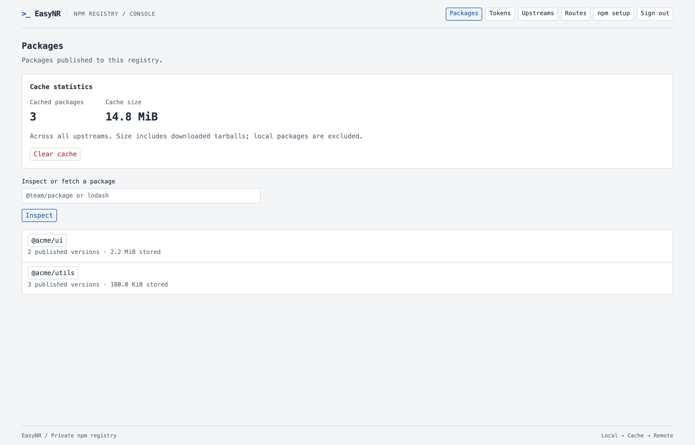
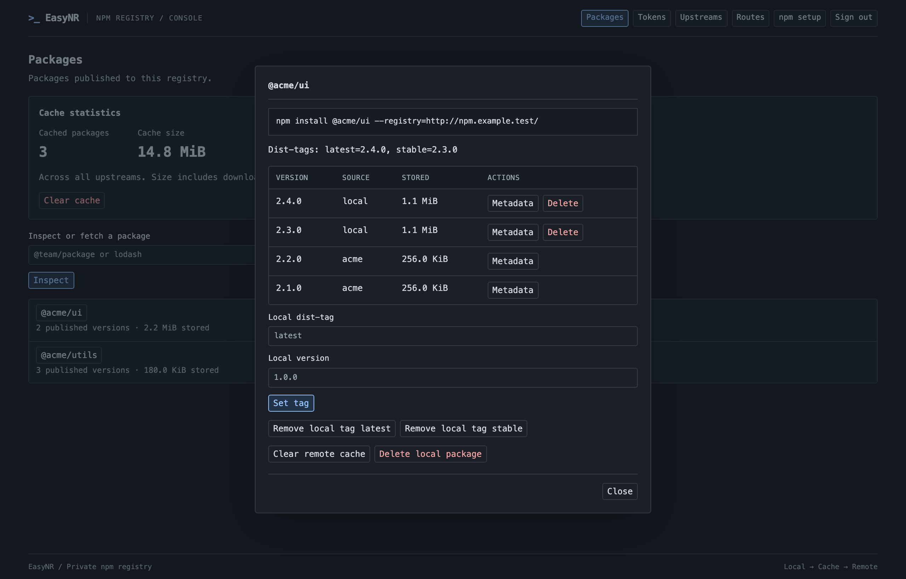
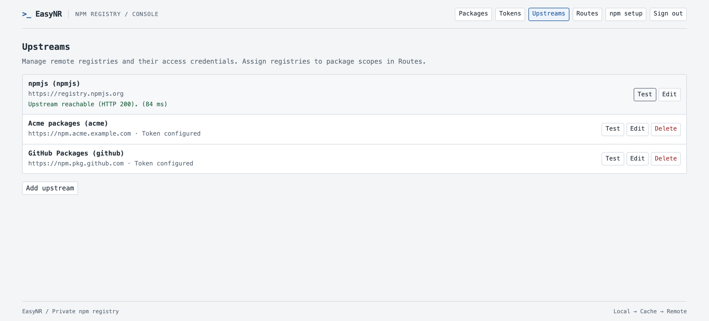
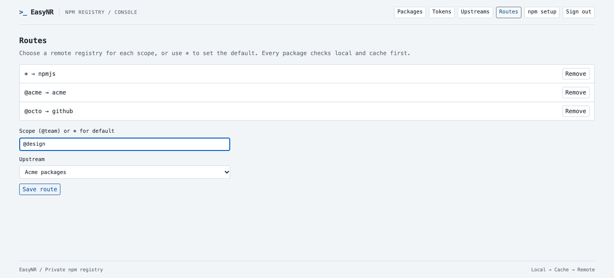

# EasyNR

**Host your npm packages. Cache the packages you depend on.**

EasyNR is a self-hosted npm registry with a built-in web console. Publish your
team's packages, proxy npmjs or another registry, and reuse downloaded packages
from a local cache. Deploy it as one Go binary or a Docker container, with no
external database or Node.js runtime required.

- **One registry for your projects** — use standard `npm publish`, `install`,
  `ci` and `view` commands with both scoped and unscoped packages.
- **Local → cache → remote** — local versions take priority, while missing
  versions come from the selected upstream and are cached on demand.
- **Multiple upstreams** — connect npmjs, GitHub Packages or another npm registry,
  assign remotes by scope, and test their connectivity from the console.
- **Scoped access tokens** — grant read or write access to an exact package,
  an entire `@scope/*`, or the registry; revoke tokens whenever needed.
- **A console that stays out of your way** — browse versions and dist-tags,
  check cache usage, clear remote cache, and manage upstreams and routes.

[Quick start](#quick-start) · [Screenshots](#screenshots) · [Docker](#docker) ·
[Upstreams and routes](#upstreams-and-routes) · [Operations](docs/operations.md)

## Screenshots

Browse packages published to your registry and see remote cache usage on the home page.



<details>
<summary>Package details, upstreams and routes</summary>

### Package details

Inspect versions, their source and stored size, then manage local dist-tags.
The console follows your system's light or dark theme.



### Upstreams

Manage registry URLs and credentials, and check a saved upstream with **Test**.



### Routes

Choose a remote for each scope and set a default for everything else.



</details>

*Screenshots show demo data rendered by the actual console. Regenerate them with
`npm run screenshots` after installing the browser development dependencies.*

## Quick start

Build from source with Go 1.26+ (tested with 1.26.5):

```sh
make build
./bin/easynr
```

Open <http://localhost:4873>. The first startup prints the admin password once
in the server log (`bootstrap_admin_password password=...`). Sign in and create
a token under **Tokens**, for example with these grants:

```text
@team/* write
* read
```

Save the secret when shown. Set `EASYNR_TOKEN` through your secret manager and
add the following to your project's or user's `.npmrc`:

```ini
registry=http://localhost:4873/
//localhost:4873/:_authToken=${EASYNR_TOKEN}
```

```sh
npm ping
npm publish
npm install @team/example
npm ci
```

Every package download requires a token, including downloads from public
upstreams. Write access includes read access. Tokens are shown once and managed
through the console.

If npm 11 blocks an intentional local publish because that version already
exists upstream, use `npm publish --force`. EasyNR still rejects overwriting
an existing local version. See the [operations guide](docs/operations.md) for
version resolution, cache behavior and maintenance.

## Docker

Build and run locally:

```sh
cp build/.env.example build/.env
# Edit build/.env with your registry, project, and tag.
docker compose --env-file build/.env -f build/compose.yml build
# Set these shell variables to match build/.env.
docker tag "${REGISTRY}/${PROJECT}/easynr:${TAG:-latest}" easynr:local
docker run -d --name easynr \
  -p 127.0.0.1:4873:4873 \
  -v easynr_data:/data \
  easynr:local
docker logs easynr
```

Compose builds `linux/amd64` and `linux/arm64`. See [Container image build](docs/build.md)
for registry configuration, push commands, and Docker smoke tests.

The image runs as a non-root user and stores its data in `/data`. Keep the volume
when replacing the container. For a bind mount or custom runtime user, provision
the directory ownership as described in [deployment](docs/operations.md#configuration-and-deployment).

For an HTTPS deployment, put EasyNR behind a reverse proxy and set
`PUBLIC_URL=https://npm.example.com`. Preserve the original Host and Origin
headers and keep the HTTP backend private.

| Setting | Default | Purpose |
| --- | --- | --- |
| `PORT` | `4873` | Application listen port |
| `PUBLIC_URL` | Request origin | Public HTTP(S) origin used in tarball URLs |
| Data directory | `./data` (`/data` in Docker) | Local metadata and package storage |

### GitHub Container Registry

The [publish workflow](.github/workflows/publish-image.yml) runs Go verification,
then builds and pushes `linux/amd64` and `linux/arm64` images to
`ghcr.io/<owner>/<repository>` (lowercase).

It runs on pushes to `main`, release tags matching `v*`, and manual dispatches
from either of those refs. Published tags are:

- `latest` for builds from `main`.
- The exact release tag, such as `v1.0.0`.
- `sha-<full-commit-sha>` for each published build.

After the workflow has run successfully in your GitHub repository:

```sh
docker pull ghcr.io/<owner>/<repository>:latest
```

The workflow uses GitHub's built-in `GITHUB_TOKEN` with `packages: write`; no
personal access token is needed. GitHub repository policy must allow package
publishing. New GHCR packages are private by default; choose public visibility
if you want unauthenticated pulls. For an existing package, grant the repository
Actions access to publish updates.

## Upstreams and routes

EasyNR uses `https://registry.npmjs.org` by default. Add other registries in
**Upstreams**, including an optional Bearer token, then assign them in **Routes**:

| Route | Remote |
| --- | --- |
| `*` | npmjs, or your preferred default registry |
| `@company` | Your company's npm registry |
| `@octo` | GitHub Packages |

A route chooses the remote to consult after local and cached content. Versions
from local storage and that remote appear together; local versions and dist-tags
win when names overlap. Use **Test** to check a saved upstream's npm ping endpoint.

Metadata is refreshed after five minutes. If a remote becomes unavailable,
EasyNR can serve previously cached metadata and downloaded tarballs. The home
page shows cached package count and deduplicated tarball size. **Clear cache**
removes remote cache references; offline GC reclaims the unreferenced files.

EasyNR is designed for a single admin and one instance using local disk. See
[operations and supported limits](docs/operations.md) for backups, password
recovery, GC, permissions and compatibility details, or the
[OpenAPI contract](docs/openapi.yaml) for integration.

## Development

The console uses embedded HTML, CSS and JavaScript, with no frontend build step.
Node.js is only needed for optional browser tests and screenshot generation.

```sh
make verify          # formatting, vet, Go race tests, build and module checks
make test-e2e        # real npm CLI against disposable local registries
make test-docker     # prebuilt image required; see docs/build.md
npm ci
npx playwright install chromium
npm run test:ui      # live console tests on desktop and mobile Chromium
npm run screenshots  # regenerate the demo images in this README
```

See [verification results](docs/verification.md) for checks performed and their
limits, and [install performance](docs/performance.md) for reproducible container
measurements. Run `make help` for all build and development targets.
